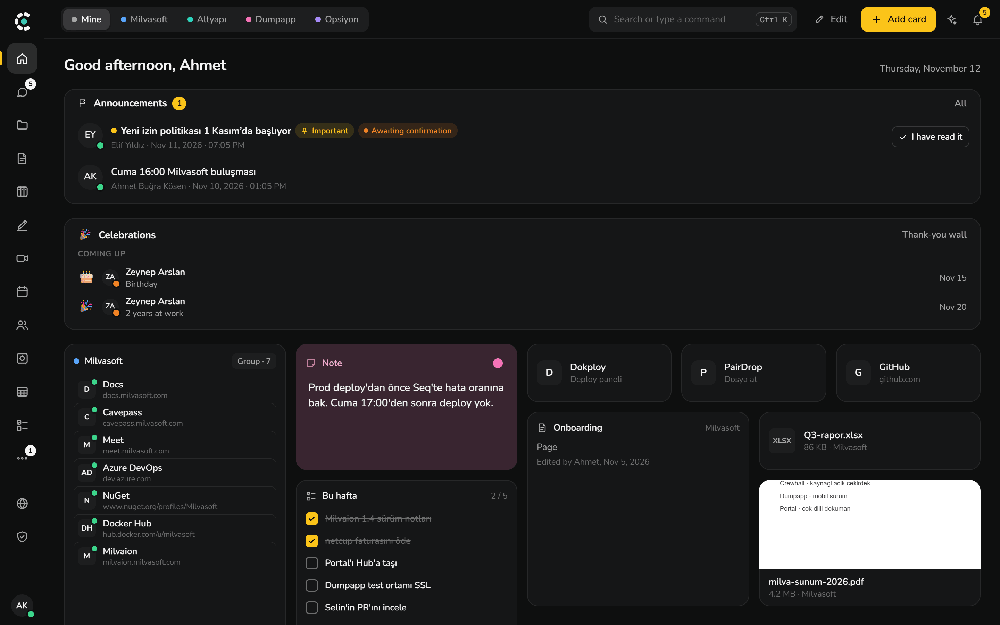
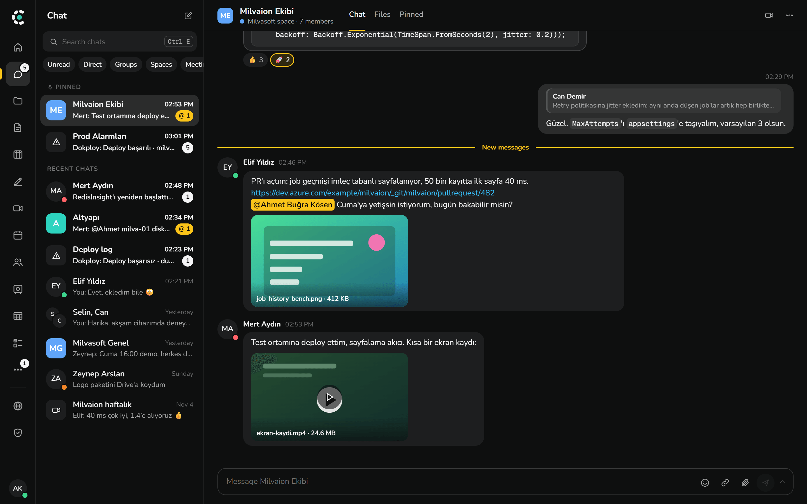
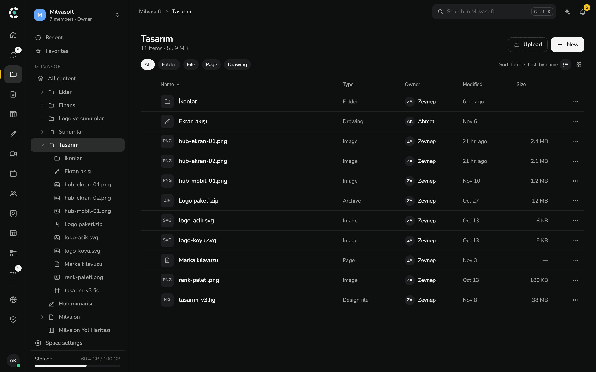
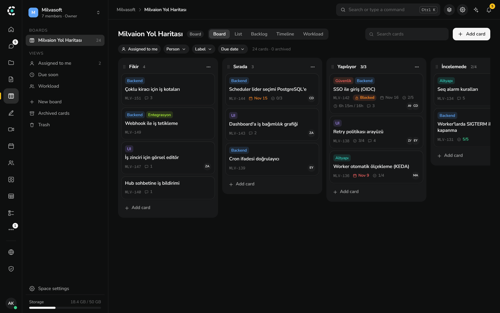
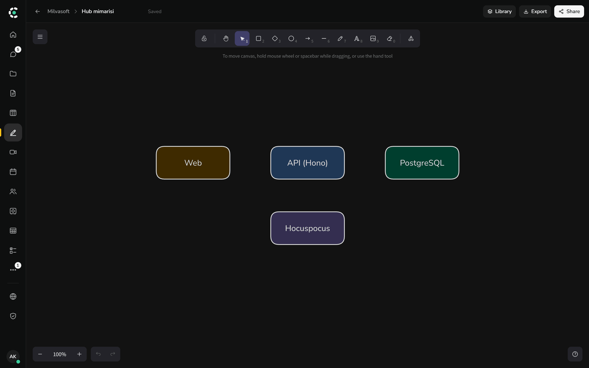

<p align="center">
  
</p>

<h1 align="center">Crewhall</h1>

<p align="center">
  <b>Your team's workspace, on your own server.</b><br>
  Chat, Drive, pages, boards, drawings, meetings, a zero-knowledge vault and a documentation
  portal in one app that you host yourself.
</p>

<p align="center">
  <a href="LICENSE"></a>
  
  
  
</p>

<p align="center">
  <a href="#run-it-on-a-server">Run it</a> ·
  <a href="#develop">Develop</a> ·
  <a href="#license">License</a> ·
  <a href="CONTRIBUTING.md">Contribute</a> ·
  <a href="README.tr.md">Türkçe</a>
</p>



## Why Crewhall

- **One place instead of five subscriptions.** Messages, files, docs, tasks and meetings share one
  sign-in, one search (<kbd>Ctrl</kbd> <kbd>K</kbd>) and one permission model.
- **Your data stays on your server.** It runs on a single Linux machine with Docker Compose, and the
  vault is end-to-end encrypted, so the server never sees what is stored in it.
- **It looks like your company.** The organization's name, logo and colors come from the admin
  panel; the product name stays out of the way.
- **Built to be extended.** Plugins add tabs, cards, commands and tools, and MCP lets AI assistants
  work in the workspace with the scopes you give them.

## A look around

<table>
  <tr>
    <td width="50%"></td>
    <td width="50%"></td>
  </tr>
  <tr>
    <td><b>Chat</b>: channels, direct messages, threads, reactions, file previews and calls.</td>
    <td><b>Drive</b>: folders, sharing, versions, trash and previews, with pages, boards and drawings beside the files.</td>
  </tr>
  <tr>
    <td></td>
    <td></td>
  </tr>
  <tr>
    <td><b>Boards</b>: kanban, list, backlog with sprints, timeline and workload views.</td>
    <td><b>Drawings</b>: a shared whiteboard that the whole team edits at once.</td>
  </tr>
</table>

<sub>The screenshots show the English interface with the Turkish sample organization that the
development setup loads.</sub>

## Features

| Area         | What you get                                                                                  |
| ------------ | --------------------------------------------------------------------------------------------- |
| **Home**     | Quick access cards, links, notes, announcements and team celebrations.                        |
| **Chat**     | Channels, direct messages, threads, reactions, calls, bots and webhooks.                      |
| **Drive**    | Folders, sharing, versions, trash and previews; Office editing through an optional service.   |
| **Pages**    | A wiki with real-time collaboration, templates and imports from Markdown, Notion and Outline. |
| **Boards**   | Task boards with sprints, timeline, workload and card dependencies.                           |
| **Drawings** | A shared whiteboard.                                                                          |
| **Meetings** | Video meetings on LiveKit, with persistent rooms and guests.                                  |
| **Calendar** | Personal and space calendars, rooms and desks, and Google or Microsoft calendar sync.         |
| **Vault**    | Zero-knowledge password sharing. The server never sees decrypted data.                        |
| **Portal**   | A public documentation and blog site managed from the workspace.                              |
| **Identity** | Email and password, TOTP, passkeys, OIDC and directory sign-in.                               |
| **Plugins**  | An SDK for tabs, cards, commands and tools. See [packages/plugin-sdk](packages/plugin-sdk).   |
| **MCP**      | Connect AI assistants to the workspace with per-connection scopes and approvals.              |
| **Clients**  | The web app and a Windows and macOS desktop app. The interface is in English and Turkish.     |

## Run it on a server

Crewhall runs on one Linux server with Docker Compose. The full guide, currently in Turkish, is in
[docs/kurulum.md](docs/kurulum.md).

```bash
git clone https://github.com/Milvasoft/crewhall.git && cd crewhall
cp docker/.env.example docker/.env
```

Fill in `docker/.env` as the guide describes, then start the stack from `docker/compose.yml`.

## Develop

You need Node 22, Docker and pnpm (`corepack enable`).

```bash
tools/dev-up/dev-up.sh
```

This starts Postgres, S3 storage and a mail catcher, creates the local `.env` files, seeds a sample
organization and runs the API, the collaboration server and the web app. `tools/dev-up/dev-up.ps1`
does the same on Windows.

Before you send a change, this must pass:

```bash
pnpm turbo run typecheck lint test
```

## Stack

| Area      | Technology                                            |
| --------- | ----------------------------------------------------- |
| API       | Node 22, Hono, Drizzle, PostgreSQL 17, better-auth    |
| Real time | `ws`, Hocuspocus and Yjs                              |
| Web       | React 19, Vite, TanStack Router and Query, Tailwind 4 |
| Desktop   | Electron                                              |
| Portal    | Next.js                                               |
| Storage   | Any S3-compatible service, SeaweedFS by default       |
| Jobs      | pg-boss                                               |
| Packaging | pnpm and Turborepo; Docker Compose for deployment     |

## Not included

The central plugin marketplace service and the mobile app are not part of this repository. Plugins
can still be installed from your own server, and `MARKETPLACE_URL` sets which marketplace the
backend talks to.

## License

Crewhall is **source-available**: the code is public and free to use, but it may not be sold. It is
licensed under the Apache License 2.0 with the [Commons Clause](https://commonsclause.com). Because
of that condition it is not "open source" as the Open Source Initiative defines the term. The
[LICENSE](LICENSE) file is what counts; this table is a summary.

| You may                                                    | You may not                                          |
| ---------------------------------------------------------- | ---------------------------------------------------- |
| Use it for free, alone or inside a company of any size     | Sell Crewhall or a product built substantially on it |
| Run it on your own servers for your own people             | Offer it to others as a paid hosted service          |
| Read, change and fork the code                             | Charge for consulting or support related to Crewhall |
| Share your copy with others, with the license notices kept |                                                      |

`packages/plugin-sdk` and `apps/plugin-hello` are MIT licensed, so you can build and sell plugins
freely. The Crewhall and Milvasoft names and logos are not licensed; a fork that is distributed
should use its own name and logo.

For a commercial license, contact [Milvasoft](https://www.milvasoft.com).

## Contributing and security

Issues and pull requests are welcome, in English or Turkish. See [CONTRIBUTING.md](CONTRIBUTING.md)
for how a change gets in, and [SECURITY.md](SECURITY.md) for reporting a vulnerability privately.
