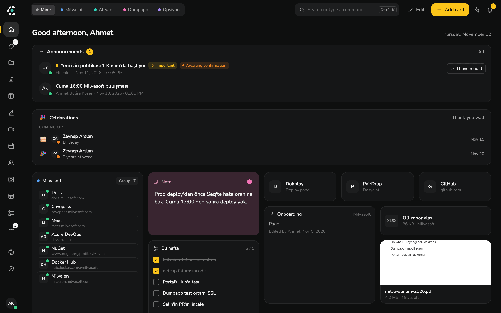
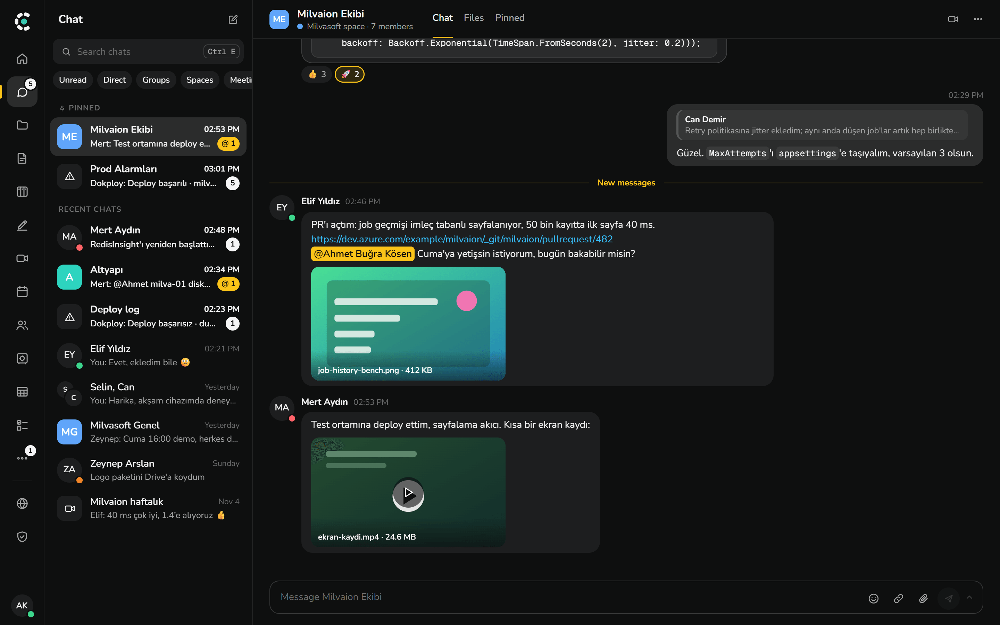
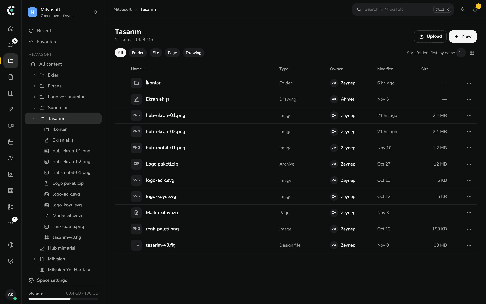
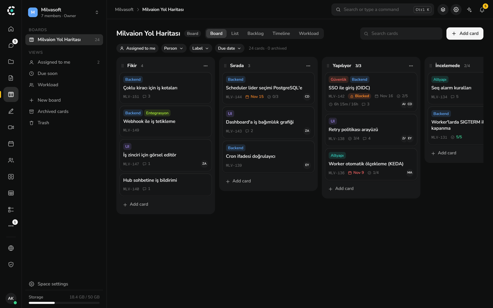
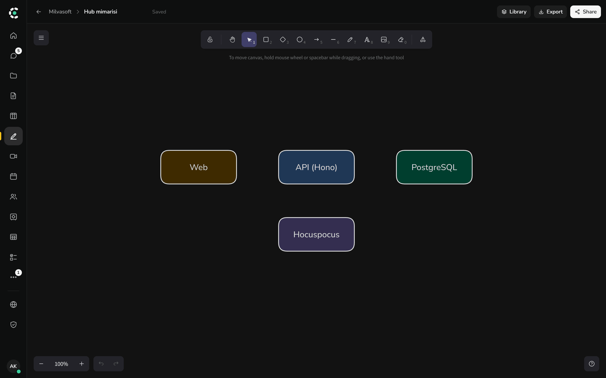

<p align="center">
  
</p>

<h1 align="center">Crewhall</h1>

<p align="center">
  <b>Ekibinin çalışma alanı, kendi sunucunda.</b><br>
  Sohbet, Drive, sayfalar, panolar, çizimler, toplantılar, sıfır bilgili kasa ve belge portalı;
  hepsi kendi sunucunda çalıştırdığın tek bir uygulamada.
</p>

<p align="center">
  <a href="LICENSE"></a>
  
  
  
</p>

<p align="center">
  <a href="#sunucuya-kurulum">Kurulum</a> ·
  <a href="#geliştirme">Geliştirme</a> ·
  <a href="#lisans">Lisans</a> ·
  <a href="CONTRIBUTING.md">Katkı</a> ·
  <a href="README.md">English</a>
</p>



## Neden Crewhall

- **Beş ayrı abonelik yerine tek yer.** Mesajlar, dosyalar, belgeler, görevler ve toplantılar tek
  girişi, tek aramayı (<kbd>Ctrl</kbd> <kbd>K</kbd>) ve tek yetki modelini paylaşır.
- **Veri senin sunucunda kalır.** Docker Compose ile tek bir Linux sunucuda çalışır. Kasa uçtan uca
  şifrelidir; sunucu içindekini hiç görmez.
- **Kurumuna benzer.** Kurumun adı, logosu ve renkleri yönetim panelinden gelir; ürün adı geri planda
  kalır.
- **Genişletilebilir.** Eklentiler sekme, kart, komut ve araç ekler; MCP ile yapay zekâ asistanları
  verdiğin yetkilerle çalışma alanında iş yapar.

## Kısa bir tur

<table>
  <tr>
    <td width="50%"></td>
    <td width="50%"></td>
  </tr>
  <tr>
    <td><b>Sohbet</b>: kanallar, özel mesajlar, yanıt dizileri, tepkiler, dosya önizlemeleri ve aramalar.</td>
    <td><b>Drive</b>: klasörler, paylaşım, sürümler, çöp kutusu ve önizleme; dosyaların yanında sayfa, pano ve çizimler.</td>
  </tr>
  <tr>
    <td></td>
    <td></td>
  </tr>
  <tr>
    <td><b>Panolar</b>: kanban, liste, sprintli backlog, zaman çizelgesi ve iş yükü görünümleri.</td>
    <td><b>Çizimler</b>: bütün ekibin aynı anda düzenlediği ortak beyaz tahta.</td>
  </tr>
</table>

<sub>Ekran görüntüleri, geliştirme ortamının yüklediği Türkçe örnek kurumla İngilizce arayüzü
gösterir.</sub>

## Özellikler

| Alan            | Neler var                                                                                      |
| --------------- | ---------------------------------------------------------------------------------------------- |
| **Ana sayfa**   | Hızlı erişim kartları, bağlantılar, notlar, duyurular ve ekip kutlamaları.                     |
| **Sohbet**      | Kanallar, özel mesajlar, yanıt dizileri, tepkiler, aramalar, botlar ve webhook'lar.            |
| **Drive**       | Klasörler, paylaşım, sürümler, çöp kutusu, önizleme; isteğe bağlı servisle Office düzenleme.   |
| **Sayfalar**    | Gerçek zamanlı ortak düzenlemeli wiki, şablonlar; Markdown, Notion ve Outline'dan içe aktarma. |
| **Panolar**     | Sprint, zaman çizelgesi, iş yükü ve kart bağımlılıklarıyla görev panoları.                     |
| **Çizimler**    | Ortak beyaz tahta.                                                                             |
| **Toplantılar** | LiveKit üzerinde görüntülü toplantı, kalıcı odalar ve misafirler.                              |
| **Takvim**      | Kişisel ve space takvimleri, oda ve masa rezervasyonu, Google ve Microsoft takvim eşitleme.    |
| **Kasa**        | Sıfır bilgili parola paylaşımı. Sunucu çözülmüş veriyi hiç görmez.                             |
| **Portal**      | Çalışma alanından yönetilen herkese açık belge ve blog sitesi.                                 |
| **Kimlik**      | E-posta ve şifre, TOTP, passkey, OIDC ve dizin girişi.                                         |
| **Eklentiler**  | Sekme, kart, komut ve araç eklemek için SDK. Bkz. [packages/plugin-sdk](packages/plugin-sdk).  |
| **MCP**         | Yapay zekâ asistanlarını bağlantı başına yetki ve onayla çalışma alanına bağlama.              |
| **İstemciler**  | Web ile Windows ve macOS masaüstü uygulaması. Arayüz Türkçe ve İngilizce.                      |

## Sunucuya kurulum

Crewhall tek bir Linux sunucuda Docker Compose ile çalışır. Adım adım anlatım
[docs/kurulum.md](docs/kurulum.md) dosyasındadır.

```bash
git clone https://github.com/Milvasoft/crewhall.git && cd crewhall
cp docker/.env.example docker/.env
```

`docker/.env` dosyasını belgedeki gibi doldurup yığını `docker/compose.yml` ile başlat.

## Geliştirme

Node 22, Docker ve pnpm (`corepack enable`) gerekir.

```bash
tools/dev-up/dev-up.sh
```

Bu komut Postgres, S3 deposu ve e-posta yakalayıcıyı başlatır, yerel `.env` dosyalarını oluşturur,
örnek bir kurum yükler; API, ortak düzenleme sunucusu ve web uygulamasını çalıştırır. Windows'ta
`tools/dev-up/dev-up.ps1` aynı işi yapar.

Değişiklik göndermeden önce şunun geçmesi gerekir:

```bash
pnpm turbo run typecheck lint test
```

## Teknoloji

| Alan           | Teknoloji                                            |
| -------------- | ---------------------------------------------------- |
| API            | Node 22, Hono, Drizzle, PostgreSQL 17, better-auth   |
| Gerçek zamanlı | `ws`, Hocuspocus ve Yjs                              |
| Web            | React 19, Vite, TanStack Router ve Query, Tailwind 4 |
| Masaüstü       | Electron                                             |
| Portal         | Next.js                                              |
| Depolama       | S3 uyumlu herhangi bir servis, varsayılan SeaweedFS  |
| İş kuyruğu     | pg-boss                                              |
| Paketleme      | pnpm ve Turborepo; dağıtım için Docker Compose       |

## Bu depoda olmayanlar

Merkezî eklenti pazar yeri servisi ve mobil uygulama bu depoda değildir. Eklentiler yine kendi
sunucundan kurulabilir. Backend'in hangi pazar yeriyle konuşacağını `MARKETPLACE_URL` belirler.

## Lisans

Crewhall **kaynağı açık** bir yazılımdır: kod herkese açıktır ve ücretsiz kullanılır, ama satılamaz.
Lisansı Apache License 2.0 ile [Commons Clause](https://commonsclause.com) koşuludur. Bu koşul
nedeniyle Open Source Initiative'in tanımıyla "açık kaynak" sayılmaz. Bağlayıcı olan
[LICENSE](LICENSE) dosyasıdır, bu tablo yalnız özettir.

| Yapabilirsin                                                    | Yapamazsın                                                 |
| --------------------------------------------------------------- | ---------------------------------------------------------- |
| Tek başına veya her büyüklükte şirket içinde ücretsiz kullanmak | Crewhall'ı ya da büyük ölçüde ona dayanan bir ürünü satmak |
| Kendi sunucunda kendi insanların için çalıştırmak               | Başkalarına ücretli barındırma hizmeti olarak sunmak       |
| Kodu okumak, değiştirmek, fork etmek                            | Crewhall ile ilgili ücretli danışmanlık veya destek vermek |
| Lisans bildirimlerini koruyarak başkalarıyla paylaşmak          |                                                            |

`packages/plugin-sdk` ve `apps/plugin-hello` MIT lisanslıdır, eklenti yapıp satabilirsin. Crewhall
ve Milvasoft adları ile logoları lisansa dahil değildir; dağıtılan bir fork kendi adını ve logosunu
kullanmalıdır.

Ticari lisans için [Milvasoft](https://www.milvasoft.com) ile iletişime geç.

## Katkı ve güvenlik

Issue ve pull request'ler Türkçe ya da İngilizce olabilir. Bir değişikliğin nasıl girdiği
[CONTRIBUTING.md](CONTRIBUTING.md) dosyasında, güvenlik açığını gizlice bildirme yolu
[SECURITY.md](SECURITY.md) dosyasındadır.
