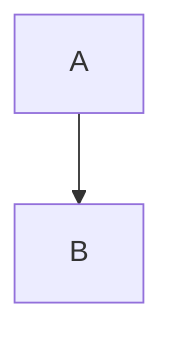

import Tabs from '@theme/Tabs';
import TabItem from '@theme/TabItem';

# Setup

:::tip Before you start
Install Node.
:::

## Install

<Tabs>
<TabItem value="npm" label="npm">

```bash title="terminal"
npm install acme
```

</TabItem>
<TabItem value="pnpm" label="pnpm">

```bash
pnpm add acme
```

</TabItem>
</Tabs>




Back to the [intro](../intro.md).
